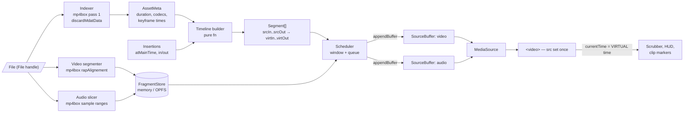
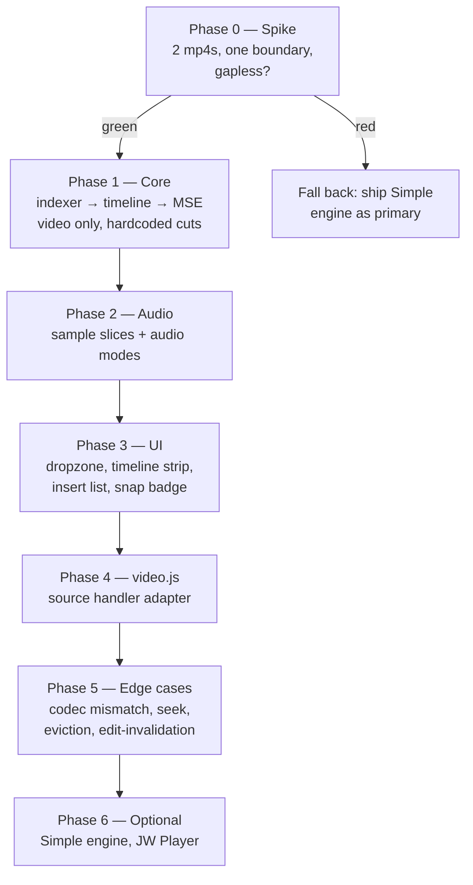

# 00 — Architecture & Build Order

## Goal

One `<video>`-equivalent element. `src` is set **once**. Never reloaded. Playback
is continuous across main video and every injected clip, and the transport bar
shows a single timeline.

## Non-goals (v1)

No export/download. No re-encoding. No upload — files never leave the machine.
No backend. Chrome only (Safari plan lives in `08-safari-next-steps.md`).

## The one invariant

```
MediaSource object is created once per session.
video.src = URL.createObjectURL(mediaSource) is assigned once.
Everything after that is appendBuffer / remove.
```

Editing insertions never touches `src`. It invalidates the **buffer**, not the
element — see `01-virtual-timeline.md` step 8 and `03-native-mse-engine.md` step 12.

## The one constraint that shapes everything

MSE gives us a continuous byte-appendable timeline, but:

- a single SourceBuffer needs one consistent codec config,
- video can only be cut at a **RAP (keyframe)** without re-encoding,
- audio has no such limit (every AAC frame is independent).

So the pipeline is deliberately asymmetric:

| Stream | Route | Why |
|---|---|---|
| Video | mp4box segmented fMP4 fragments, spliced with `timestampOffset` | ~95% of bytes, never copied, fragment-aligned cuts are free |
| Audio | mp4box sample extraction → 1–2s AAC slices at exact sample numbers | tiny (~16 KB/s), exact cuts, so A/V stays locked |

That asymmetry is the single most important design decision here. Cutting audio
at video-keyframe granularity would give up to ~2 s of A/V drift per insertion,
and drift accumulates.

## Data flow



## Module map

```
src/
  lib/timeline/   build.ts  map.ts  validate.ts        pure, unit-tested
  lib/media/      indexer.ts  segmenter.ts  audioSlicer.ts  codec.ts  store.ts
  lib/engine/     types.ts  MseEngine.ts  SimpleEngine.ts
                  videojs/sourceHandler.ts  jwplayer/blobEngine.ts
  lib/export/     (removed from v1 — kept only as the JW remux helper)
  state/          project.ts   (zustand: assets, insertions, engine, audioMode)
  components/     AssetDropzone  PlayerSurface  Timeline  InsertList
                  EngineSelect   AudioModeSelect  DiagnosticHud
```

## Engine contract

Every engine implements the same surface so no component branches on engine id:

```ts
interface PlayerEngine {
  mount(el: HTMLElement, video: HTMLVideoElement): Promise<void>;
  setTimeline(tl: Timeline): Promise<void>;   // full rebuild, src untouched
  play(): Promise<void>;
  pause(): void;
  seekVirtual(t: number): void;
  get currentTime(): number;                  // always VIRTUAL time
  on(ev: 'time'|'buffered'|'state'|'error', cb): void;
  destroy(): void;
}
```

## Build order



Ordered task list, each item independently verifiable:

1. Scaffold (Vite + React + TS + Tailwind + zustand + vitest).
2. `lib/timeline` + tests. **No media involved yet.** Do not proceed until green.
3. `lib/media/indexer.ts` — log duration, codecs, keyframe times to the HUD.
4. `lib/media/codec.ts` — mime builder + `MediaSource.isTypeSupported` gate.
5. `lib/media/segmenter.ts` — video fragments into `FragmentStore`, one asset.
6. `lib/engine/MseEngine.ts` — single asset, full-file playback, no cuts.
7. First splice: hardcoded insertion at keyframe N, verify gapless by ear + `buffered` ranges.
8. Wire timeline → scheduler, add/remove insertions at runtime.
9. `lib/media/audioSlicer.ts` + audio SourceBuffer + sync check.
10. Audio mode dropdown.
11. UI: dropzone, timeline strip, insert list, snap badge, HUD.
12. Multi-clip: 5 insertions, seeking through all of them.
13. Workbook save/load (edit JSON only, no media).
14. video.js source handler.
15. Codec mismatch detection + graceful degradation message.

## Decision log

| # | Decision | Why |
|---|---|---|
| D1 | Insert points snap to the nearest video **fragment start** (RAP), drift shown in UI | no re-encode in v1 |
| D2 | Audio cut at exact sample boundary, independent of video cut | prevents cumulative A/V drift |
| D3 | Two SourceBuffers (video, audio), not one muxed | allows independent offsets; Safari needs muxed → `08` |
| D4 | `timestampOffset` splicing, not byte-level tfdt rewriting | no muxer in the hot path |
| D5 | Edits flush + re-append, never re-create MediaSource | satisfies "no reload" |
| D6 | video.js **8.24.1**, not 10.x | v10 removed Tech/source handlers (verified in `dist/`) |
| D7 | JW Player via pre-remuxed blob, not playlist | no MSE extension point exists |
| D8 | v1 = Chrome 111+; Safari is a documented follow-up | halves the MSE edge-case surface |
