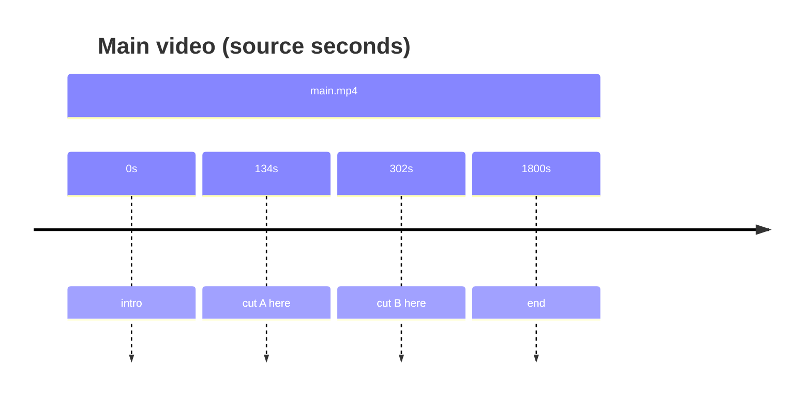
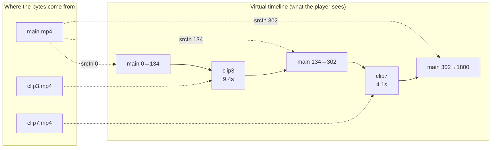
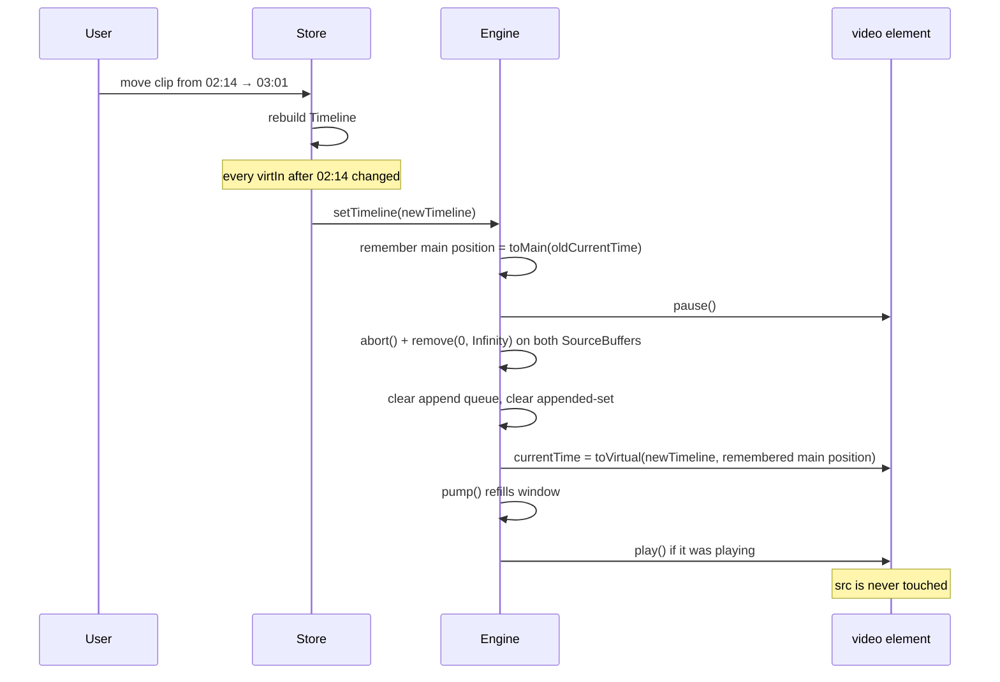

# 01 — Virtual Timeline (the shared spine)

Every engine uses this. It is pure TypeScript with no media dependency, so it is
built and unit-tested before anything touches an MP4.

## Why it exists

The player must swallow N+1 sources and expose **one** monotonically increasing
`currentTime`. That means a bijection between "where you are in the main video"
and "where you are in the result". Everything else — the scrubber, the clip
markers, the scheduler, the clip blocks on the track — reads from it.

## Types

```ts
type AssetKind = 'main' | 'clip';

interface AssetMeta {
  id: string;
  kind: AssetKind;
  name: string;
  duration: number;              // seconds
  video: { codec: string; width: number; height: number; timescale: number };
  audio?: { codec: string; sampleRate: number; channels: number };
  keyframes: number[];           // ascending, includes 0
}

interface Insertion {
  id: string;
  clipId: string;
  atMainTime: number;            // what the user typed
  snappedMainTime: number;       // nearest usable cut point (D1)
  inPoint: number;               // trim inside the clip
  outPoint: number;
}

interface Segment {
  id: string;                    // stable: `${insertionId ?? 'main'}:${index}`
  kind: AssetKind;
  assetId: string;
  srcIn: number;                 // source seconds
  srcOut: number;
  virtIn: number;                // virtual seconds
  virtOut: number;
}

interface Timeline {
  segments: Segment[];
  duration: number;              // = last virtOut
  mainDuration: number;
}
```

`srcOut - srcIn` and `virtOut - virtIn` are always equal. That equality is the
whole trick: virtual time is just source time plus an offset **that changes per
segment**.

## Step 1 — Snap insertions to usable cut points

A cut is only legal on a video keyframe. Also, in the MSE engine a cut is only
*cheap* on a **fragment** start, and with keyframe-aligned fragments those are exactly
the keyframes (see `02-media-indexing.md`).

```ts
function snap(at: number, keyframes: number[], tolerance = Infinity): number {
  // nearest keyframe, clamped into [0, mainDuration - 1/fps]
}
```

Keep both numbers. The UI shows `atMainTime` as typed and a badge
`→ snapped 02:14.08 (+0.08s)` so the user is never surprised by the drift.

If `tolerance` is finite and no keyframe is within it, the insertion is rejected
with a reason rather than silently moved.

## Step 2 — Walk the main video and lay clips inline

```ts
function buildTimeline(main: AssetMeta, clips: Map<string, AssetMeta>, ins: Insertion[]): Timeline {
  const sorted = [...ins].sort((a, b) => a.snappedMainTime - b.snappedMainTime || a.id.localeCompare(b.id));
  const segments: Segment[] = [];
  let m = 0;   // cursor in main source seconds
  let v = 0;   // cursor in virtual seconds

  for (const i of sorted) {
    const cut = clamp(i.snappedMainTime, m, main.duration);
    if (cut > m) {
      segments.push({ kind: 'main', assetId: main.id, srcIn: m, srcOut: cut, virtIn: v, virtOut: v + (cut - m) });
      v += cut - m;
      m = cut;
    }
    const dur = i.outPoint - i.inPoint;
    segments.push({ kind: 'clip', assetId: i.clipId, srcIn: i.inPoint, srcOut: i.outPoint, virtIn: v, virtOut: v + dur });
    v += dur;
  }
  if (m < main.duration) {
    segments.push({ kind: 'main', ... srcIn: m, srcOut: main.duration, virtIn: v, virtOut: v + (main.duration - m) });
    v += main.duration - m;
  }
  return { segments, duration: v, mainDuration: main.duration };
}
```

Three behaviours fall out of this loop for free:

- **Two insertions at the same cut point** chain (clip A then clip B) because
  `cut > m` is false for the second one.
- **An insertion at 0** puts the clip before any main video.
- **An insertion at the very end** appends the clip after the tail.

Before / after:





## Step 3 — The mapping functions

Virtual duration = main duration + Σ clip durations. So:

```
virtOf(m) = m + Σ dur(i) for every insertion whose snappedMainTime <= m
```

Half-open intervals matter. Use `[in, out)` everywhere:

```ts
function toVirtual(t: Timeline, mainT: number): number;   // clamps to [0, duration]
function toMain(t: Timeline, virtT: number): number;      // returns the main-time
                                                          // "anchor" while inside a clip
```

**While the playhead is inside a clip, `toMain` has no meaningful answer.** Define
it explicitly and let the UI decide: return the cut point the clip was inserted
at. The HUD then reads `main 02:14 (clip 3 playing)`. Getting this wrong later
produces confusing scrubber labels, so pin it now with a test.

Watch the edge: at `virtT` exactly equal to a segment boundary, `toMain` must
return the *later* segment's `srcIn`. A one-frame off-by-one here is what makes
"seek to end of clip" land at the previous frame forever.

## Step 4 — Locate a virtual time

The scheduler needs, for a virtual time, the segment and the corresponding source
time:

```ts
function locate(t: Timeline, virtT: number): { seg: Segment; index: number; srcTime: number };
// srcTime = seg.srcIn + (virtT - seg.virtIn)
```

Binary search, not `find()` — this runs on every `timeupdate` and every append
decision.

## Step 5 — Windows

The scheduler and the eviction logic both want "which segments overlap
`[a, b)`":

```ts
function segmentsIn(t: Timeline, a: number, b: number): Segment[];
```

This is where clip markers on the scrubber come from too, so it must return
segments in virtual order and cope with a window fully inside one segment.

## Step 6 — Validation

Run on every edit, return typed failures the UI can render inline:

| Check | Rule | Message |
|---|---|---|
| Overlap | insertions must not share a `snappedMainTime` unless intentionally chained | "Clip 3 and clip 7 would start at the same frame" |
| Empty | `outPoint > inPoint` and `≤ clip.duration` | "Clip 3 is trimmed to zero length" |
| Missing media | every insertion's `clipId` resolves | "Clip 3 was removed from the library" |
| Cut outside main | `0 ≤ snappedMainTime < main.duration` | "Insert time is past the end of the main video" |
| Codec | clip codec config == main codec config | "Clip 4 is 1080p60 HEVC; main is 1080p30 H.264 → use the Simple engine" |

Codec mismatch is **not** an error in the timeline, it is an error for the *MSE
engine*. Keep the timeline engine-agnostic and let the engine refuse with a
capability report.

## Step 7 — Stability

Segment ids must be stable across rebuilds so the scheduler can tell "this
fragment was already appended" from "this is new". Derive them from
`insertionId` + index, never from array position.

## Step 8 — What an edit invalidates



The visible cost of an edit is a short re-buffer at the playhead, not a reload.
Preserving the **main** position (not the virtual one) is what makes this feel
right: you stay on the frame you were watching.

## Acceptance checklist

- [ ] `toVirtual(toMain(x)) === x` for random `x` across a timeline with 5 clips.
- [ ] Boundary law: `toMain(dur)` = main duration; `toMain(0)` = 0.
- [ ] Two clips at the same cut point chain in list order.
- [ ] Clip at 0 and clip at end both produce valid timelines.
- [ ] `segments` is contiguous: `seg[i].virtOut === seg[i+1].virtIn` with no gaps.
- [ ] `duration === mainDuration + Σ clipDur`.
- [ ] 1000 random edits never throw or produce a non-contiguous timeline.
