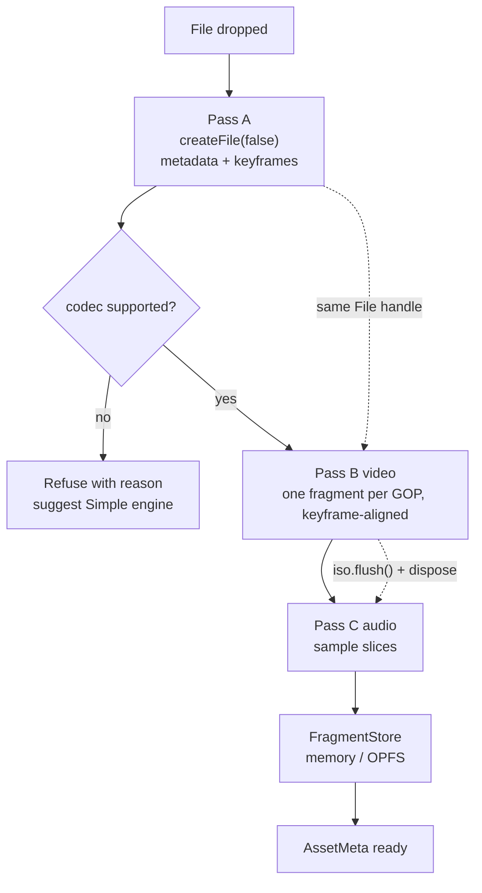

# 02 — Media Indexing & Fragmentation (shared by engines A, C, D)

Turns a `File` into things the player can append: codec config, a keyframe index,
and byte ranges already formatted as fragmented MP4. Uses **mp4box 2.5.0**.
Verified against its type definitions:

- `createFile(keepMdatData?, stream?, options?)` — pass `false` to discard mdat payloads
- `info.videoTracks[0].codec` → `"avc1.64001f"`
- `getTrackSamplesInfo(trackId)` → `{dts, cts, duration, is_sync, size, offset, number}[]`
- `setSegmentOptions(id, user, { rapAlignement, nbSamples, normalizeAudioSampleEntriesForMSE })`
- `initializeSegmentation('per-track')` → `[{ id, user, buffer }]`
- `onSegment(id, user, buffer, nextSample, last)`
- `setExtractionOptions(id, user, { nbSamples })` → `onSamples(id, user, samples)`

## Reading a local file without blowing up memory

Never `file.arrayBuffer()` a 1 GB video. Feed it in slices with the required
`fileStart` property, and let mp4box yield the bytes back to the GC.

```ts
const CHUNK = 8 * 1024 * 1024;
async function feed(file: File, iso: ISOFile, onProgress: (p: number) => void, signal: AbortSignal) {
  for (let off = 0; off < file.size; off += CHUNK) {
    if (signal.aborted) throw new DOMException('aborted', 'AbortError');
    const buf = await file.slice(off, Math.min(off + CHUNK, file.size)).arrayBuffer();
    (buf as MP4BoxBuffer).fileStart = off;
    iso.appendBuffer(buf as MP4BoxBuffer, off + CHUNK >= file.size);
    onProgress(Math.min(off + CHUNK, file.size) / file.size);
  }
  iso.flush();
}
```

## Step 1 — Pass A: metadata (mdat discarded)

```ts
const iso = createFile(false);   // false = do not retain mdat data
```

`createFile(false)` is what keeps pass A flat in memory: mp4box parses `moov`,
`stbl`, and box structure but drops sample payloads. Sample **metadata** survives,
which is all we need.

## Step 2 — Pull the facts

```ts
const info = await new Promise<Movie>(res => (iso.onReady = res));

{
  duration: info.duration / info.timescale,
  video: {
    codec: info.videoTracks[0].codec,          // "avc1.64001f"
    width: info.videoTracks[0].video.width,
    height: info.videoTracks[0].video.height,
    timescale: info.videoTracks[0].timescale,
  },
  audio: info.audioTracks[0] && {
    codec: info.audioTracks[0].codec,          // "mp4a.40.2"
    sampleRate: info.audioTracks[0].audio.sample_rate,
    channels: info.audioTracks[0].audio.channel_count,
    timescale: info.audioTracks[0].timescale,
  },
  isFragmented: info.isFragmented,             // already-fMP4 sources take a different path
}
```

A clip with **no audio track** is legal and expected. `audio: undefined` must flow
all the way through the timeline and the engine as "silence", never as an error.

## Step 3 — Build the keyframe index

```ts
const samples = iso.getTrackSamplesInfo(videoTrackId);
// sample.is_sync === true  →  RAP. Convert dts to seconds via timescale.
const keyframes = samples.filter(s => s.is_sync).map(s => s.dts / timescale);
```

Notes that will bite:

- Use `dts`, not `cts`, for the cut point. With B-frames these differ, and cutting
  on `cts` produces a fragment whose decode order starts mid-stream.
- Prepend `0` if the first sample is not at 0. It almost always is; edit lists
  (`edts`) can make it not.
- **Edit lists**: if `trak.edts` exists with a non-zero `media_time`, the track's
  presentation start is shifted. Chrome applies it; our offsets must match. Read
  `elst` once and store `presentationOffset` on `AssetMeta`; subtract it when
  mapping source time. If `presentationOffset !== 0`, snap cut points using
  `(dts - offset)`.
- Fragmented sources: samples come from `moof` `trun` entries; the same
  `getTrackSamplesInfo` call works, but `is_sync` may be absent → treat
  `sample_flags` bit 0x00010000 as sync.

### Decoder configuration fingerprint

`AssetMeta.video` also carries `configKey` (hex of the `avcC` payload) and
`configCore` (its leading bytes, i.e. SPS head without the VUI). Two files can
report the same `codec` string — `avc1.4d401e` — and still carry different
SPS/PPS; `clip-a.mp4` and `main-fast.mp4` are exactly that pair. The fingerprint
is what makes the difference visible instead of mysterious, and drives a
non-blocking warning in the UI (`findConfigWarnings`). It does **not** block
playback: the engine appends one init per flush, so a differing clip is decoded
with the main video's configuration. See `HANDOFF.md` §7(a).

## Step 4 — Codec gate

```ts
function mseType(meta: AssetMeta): string {
  return `video/mp4; codecs="${meta.video.codec}${meta.audio ? `,${meta.audio.codec}` : ''}"`;
}
MediaSource.isTypeSupported(mseType(main));
```

A negative answer is a hard stop with a clear message, not a silent failure. Also
compare **every clip's** `video.codec`, `width`, `height` and audio config against
the main's. Mismatch → the MSE engine refuses and points the user at the Simple
engine (`04`).

Practical compatibility notes:

- `avc1` (SPS/PPS in the sample entry) is what we want. `avc3` (SPS/PPS in-band)
  generally survives but the init segment handling differs.
- HEVC in MSE on Chrome is partial; if `hvc1` shows up, gate on
  `isTypeSupported` and expect refusals.
- Different `avcC` bytes with the same codec string usually still decode, because
  Chrome re-initialises the decoder on a new init segment — but that is the
  "tier 2" case in `03-media-mse-engine.md`, and it is where artifacts appear if
  the encoder settings differ wildly. Warn, do not block.

## Step 5 — Pass B: video fragmentation

Video reuses mp4box's own fragmenter, so no bytes are copied or re-muxed.

```ts
// GOP length in samples, from the spacing between sync samples
const gopSamples = dominantGopLength(samples);
iso.setSegmentOptions(videoTrackId, 'video', { rapAlignement: false, nbSamples: gopSamples });
const [init] = iso.initializeSegmentation('per-track');   // init buffer for the video track only
iso.onSegment = (id, user, buffer, nextSample, last) => {
  // nextSample = index of the first sample NOT in this fragment
  fragments.push({ nextSample, data: new Uint8Array(buffer) });
};
iso.start();
await feed(file, iso, onProgress, signal);
```

Then convert `nextSample` into exact times using the sample table:

```ts
const startOf = (n: number) => samples[n].dts / timescale;
// fragment k spans [startOf(prevNextSample), startOf(nextSample))
```

### Why `rapAlignement: true` is the wrong switch (measured)

It reads like exactly what we want — align cuts to random-access points — but it
resolves the other way: mp4box ends a segment **at** the RAP, so every following
fragment starts *one frame after* a keyframe. Verified on `samples/main.mp4`
(keyframes at dts 0, 2.0, 4.0, 6.0 …):

| options | fragment starts |
|---|---|
| `{ rapAlignement: true, nbSamples: 1 }` | 0, 0.033, 2.033, 4.033 … (`sample0` non-sync) |
| `{ rapAlignement: true, nbSamples: 60 }` | 0, 2.033, 6.033, 10.033 … |
| `{ rapAlignement: false, nbSamples: 60 }` | **0, 2.0, 4.0, 6.0 — sync at every start** |

That one-frame offset is not cosmetic: a fragment starting at a non-sync sample
cannot be used as a splice point. After a cut the decoder has nothing buffered
before the appended fragment, so it needs a keyframe at its first sample; without
one it keeps showing the previous segment's last frame until the next keyframe
arrives — which is exactly the "clip's picture bleeds over the main video for two
seconds" bug (`HANDOFF.md` §7(f)).

So: cut on a regular sample grid whose length equals the GOP, and record whether
each cut actually landed on a sync sample:

```ts
const gopSamples = dominantGopLength(samples);   // mode of sync-sample gaps
fragments.push({ start, end, data, keyframe: first.is_sync });
```

`AssetMeta.cutPoints` is then built from `fragments.filter(f => f.keyframe)`, so a
file with irregular GOPs degrades into "fewer legal insertion points" instead of
"insertions that freeze at the seam". A 2 s GOP on a 20 min video yields ~600
fragments, a fine granularity for the queue and the UI.

**The leading stub is merged away.** Fragmentation still emits a stub for the
frames before the first keyframe (one frame at the very start). Left alone it
becomes the first cut point, so insert points snap to 0.03 s instead of the first
GOP boundary. `mergeLeadingStub` concatenates it with the next fragment (a buffer
holding `moof+mdat` twice is a valid multi-fragment append; each part keeps its own
`tfdt`).

## Step 6 — Pass C: audio samples

Audio is ~16 KB/s, so a 20 minute track is ~20 MB — small enough to slice at
**exact sample boundaries**, which is what prevents cumulative A/V drift
(decision D2).

```ts
iso.setExtractionOptions(audioTrackId, 'audio', { nbSamples: 1024 });
iso.onSamples = (id, user, samples) => {
  for (const s of samples) audioSamples.push({ dts: s.dts, duration: s.duration, data: s.data! });
};
```

Each AAC frame is independently decodable, so a cut anywhere is safe. We re-mux
these with `mp4-muxer` in audio-only mode (`new Muxer({target, audio: {codec:'aac',
sampleRate, numberOfChannels}, fastStart:'fragmented'})`), writing the **virtual**
timestamp directly into each chunk. That means the audio SourceBuffer needs no
`timestampOffset` at all — its timestamps are already virtual. Variables are
excluded from that muxer (`video` omitted), which is why it must be audio-only.

## Step 7 — `FragmentStore`

Video fragments are the memory question. Abstract the storage so a big file does
not have to live in RAM:

```ts
interface FragmentStore {
  put(key: string, data: Uint8Array): Promise<void>;
  get(key: string): Promise<Uint8Array>;
  has(key: string): Promise<boolean>;
  totalBytes(): number;
  clear(): Promise<void>;
}
```

- `MemoryStore` — default, used when the indexed media is under ~700 MB.
- `OpfsStore` — `navigator.storage.getDirectory()` + `createSyncAccessHandle()`;
  used above that threshold. Same interface, so the scheduler does not care.

Threshold is a setting in the HUD, not a hidden decision. A status line like
`indexed 412 MB in 3.1 s · store: memory` removes all mystery from load times.

## Step 8 — Lifecycle



One `ISOFile` instance per asset per pass. Always `iso.flush()` and drop the
reference before starting the next pass; two live `ISOFile`s on a large file is
the fastest way to a tab crash.

Progress should be **byte-accurate across the three passes**, so a 400 MB file
reports 0–100 % once rather than three separate bars.

## Acceptance checklist

- [ ] 20 min 1080p H.264/AAC file indexes in under ~5 s and reports correct duration.
- [ ] Keyframe times match `ffprobe -show_frames | grep key_frame` within one frame.
- [ ] Every video fragment's start time appears in the keyframe list.
- [ ] Concatenating all video fragments + init produces a file Chrome plays.
- [ ] A clip with no audio track indexes with `audio: undefined` and no warnings.
- [ ] A file with `moov` at the end (non-faststart) indexes correctly.
- [ ] Aborting mid-index leaves no dangling `ISOFile` and frees the store.
