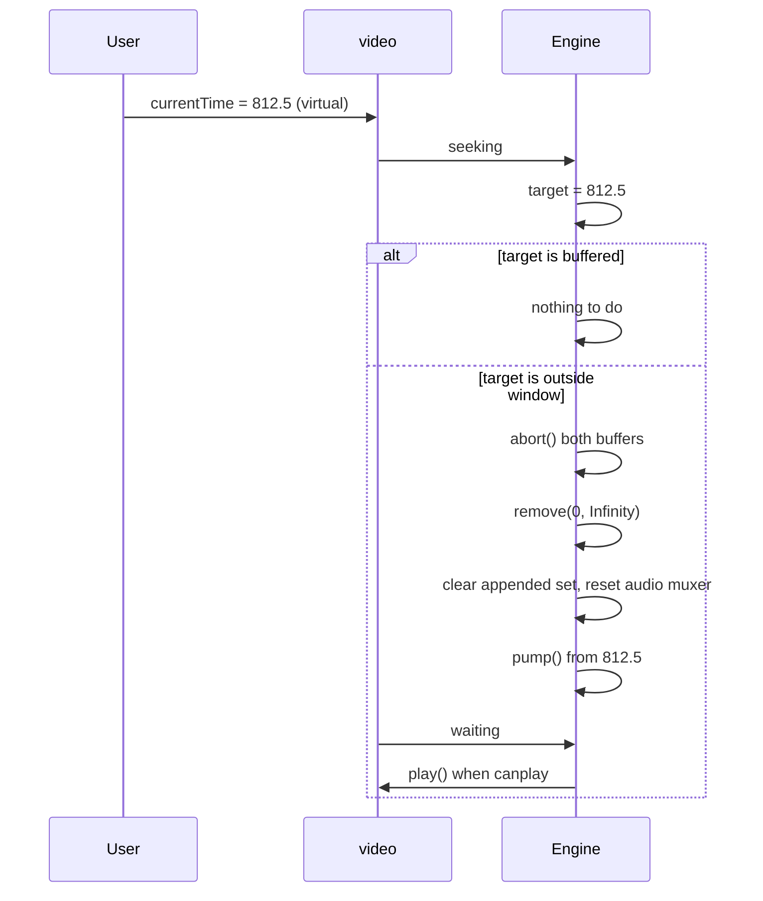

# 03 — Native MSE Engine (Method A, default)

One `<video>`, one `MediaSource`, two `SourceBuffer`s, and a scheduler that keeps
the playhead fed in virtual-timeline order. `src` is assigned exactly once.

Pre-req: `01-virtual-timeline.md` (segments) and `02-media-indexing.md` (fragments).

---

## Step 0 — Phase 0 spike (do this before building anything)

A throwaway page, no React, ~120 lines. It must answer four questions or the
whole approach changes. **Do not build the app until this is green.**

1. Two local MP4s, one hardcoded splice, video only. Is it gapless?
2. Does a second init segment appended mid-stream get accepted by Chrome
   (same codec, different file)?
3. Does leaving a hole in the audio `buffered` range play as silence without
   stalling the video?
4. Does `timestampOffset` produce a boundary with zero-pixel gap in `buffered`?

Record the answers in `docs/spike-results.md`. If 1 or 4 fails, the Simple engine
(`04`) becomes primary and MSE becomes an enhancement.

---

## Step 1 — Create the MediaSource

```ts
const ms = new MediaSource();
const url = URL.createObjectURL(ms);
video.src = url;                 // ← the only assignment, ever
video.disableRemotePlayback = true;
video.preload = 'auto';
await new Promise<void>(r => (ms.onsourceopen = () => r()));
```

`ms.onsourceopen` can also fire through `addEventListener` before the promise
resolves on a re-entrant call — set the handler before assigning `src`.

Buffering policy: `video.preload = 'auto'` plus our own lookahead. The browser's
own readahead is irrelevant here; we are the byte source.

## Step 2 — Add the SourceBuffers

```ts
const sbv = ms.addSourceBuffer(`video/mp4; codecs="${main.video.codec}"`);
const sba = main.audio ? ms.addSourceBuffer(`video/mp4; codecs="${main.audio.codec}"`) : null;
```

- `mode` must stay `'segments'` (the default). `'sequence'` re-times appended
  media and destroys our virtual mapping.
- Two buffers, not one muxed: video needs `timestampOffset` per segment, audio
  does not, and independent offsets are how A/V stays locked (decision D3).
- Do not add an audio buffer if the main has no audio track. A SourceBuffer whose
  mime declares an audio codec but receives only video init will throw.

## Step 3 — Init segments and duration

Per-track init from `initializeSegmentation('per-track')`:

```ts
appendSync(sbv, initVideo);            // one moov containing only the video track
if (sba) appendSync(sba, initAudio);
ms.duration = timeline.duration;       // virtual total, not main duration
```

Order matters on some builds: append the init, wait for `updateend`, **then** set
`ms.duration`. Setting duration first is tolerated by Chrome but makes the
initial seek bar jump from `Infinity` to the real value.

If the timeline changes (an edit changes total duration), reassign `ms.duration`.
That is allowed at any time and does not disturb buffered data.

## Step 4 — The append planner

Every `timeupdate` and every `updateend` calls `pump()`. It is idempotent and
cheap; do not try to be clever with dirty flags.

```ts
const LOOKAHEAD = 30;   // seconds to keep ahead of the playhead
const KEEP_BEHIND = 15; // seconds retained behind for instant replay

function pump() {
  const T = video.currentTime;
  for (const seg of segmentsIn(timeline, T - 2, T + LOOKAHEAD)) {
    for (const frag of videoFragmentsOf(seg)) {
      if (!appended.has(key(seg, frag))) queueVideo.push({ seg, frag });
    }
    for (const slice of audioSlicesOf(seg)) {
      if (!appended.has(key(seg, slice))) queueAudio.push({ seg, slice });
    }
  }
  drain('video');
  drain('audio');
}
```

Rules the queue must respect:

1. **Within a SourceBuffer, appends must be in increasing media time.** Sort by
   `seg.virtIn` then fragment order. Never append an older fragment after a newer
   one.
2. **One append in flight per SourceBuffer** (`sb.updating === false`), but the
   two buffers may run in parallel. Video GOP fragments are ~1–3 MB; serialising
   both behind one worker causes audio underruns on slower machines.
3. Skip fragments already in `appended`. The set is keyed by
   `${segment.id}#${fragIndex}` and cleared on flush/seek-backwards.

## Step 5 — Video append: one `timestampOffset` per segment

This is the whole splice mechanism.

```ts
function appendVideo({ seg, frag }: Job) {
  const sb = sbv;
  if (sb.updating) return requeue();
  const offset = seg.virtIn - seg.srcIn;          // constant inside a segment
  if (Math.abs(sb.timestampOffset - offset) > 1e-6) sb.timestampOffset = offset;
  sb.appendBuffer(frag.data);
  sb.onupdateend = () => { appended.add(...); drain('video'); evictMaybe(); };
}
```

Because `virtOut - virtIn === srcOut - srcIn`, the offset is constant within a
segment and changes only at a boundary. MSE shifts the fragment's internal
`tfdt` by the offset, so the media lands at exactly the virtual time — no byte
rewriting, no muxing (decision D4).

**Tier 2 (different init bytes) — measured, and rejected.** The design was to
append each clip's own init before its first fragment so Chrome reinitialises the
decoder. Measurement says no: with `clip-a.mp4` (`avc1.4d401e`, but an `avcC`
whose VUI/HRD bytes differ from the main's) Chrome accepted the second init and
then **discarded the first GOP that followed it** — a ~1.6 s frozen picture,
every time, while `currentTime` kept advancing and no error was raised. With a
byte-identical init (same file used as main and as clip) the seam was perfect.

So the engine appends **exactly one init per SourceBuffer per flush**, bundled
into the same `appendBuffer` call as the first fragment, and never re-initialises
mid-stream. Because the whole edit is required to share one codec string, the
first init is the correct configuration for every fragment. `AssetMeta.video`
records `configKey` (hex `avcC`) and `configCore` (SPS head without the VUI) so the
difference is visible instead of mysterious.

**Tail tolerance.** A segment's final fragment is kept even when it ends a
fraction of a frame past `srcOut` (`TAIL_TOLERANCE = 0.05 s`): a 30 s file's last
fragment typically ends at 30.016 s, and rejecting it dropped the final GOP. A
fragment that overruns by more than that is still skipped.

**Tier 3 (different codec string).** `sb.changeType(newMime)` then re-append the
init. Chrome-only. This flushes decoded state and usually leaves a visible
hiccup — the UI should already have warned at index time, so this is a
last-resort path, not a designed feature.

## Step 6 — Audio append: virtual timestamps, no offset

Audio slices are muxed by us with `mp4-muxer` in **audio-only** mode, and each
chunk already carries its virtual timestamp:

```ts
const muxer = new Muxer({
  target: new ArrayBufferTarget(),
  audio: { codec: 'aac', sampleRate, numberOfChannels },
  fastStart: 'fragmented',        // init + moof/mdat
  firstTimestampBehavior: 'strict',
  minFragmentDuration: 1,
});
// per sample of the segment, timestamps relative to the segment's srcIn
muxer.addAudioChunkRaw(sample.data, 'key', ts, dur);
```

Consequences, all of them learned the hard way:

- Timestamps start at **0** for the segment, so the *placement* offset is
  `segment.virtIn` — **not** `virtIn - srcIn`. The video fragments carry source
  timestamps and need the other rule; applying the video rule to audio put every
  segment after the first splice at `srcIn` seconds and silently overlapped the
  previous audio.
- One muxer per segment, thrown away afterwards: appending a second init
  mid-stream is the failure from Step 5. The first muxed buffer's init is kept and
  reused for the rest of the flush (`splitAudioSegment`).
- **A clip with no audio track must still emit audio.** Leaving a hole in the
  audio track does *not* play silently — Chrome stalls the element at the gap
  (`readyState 2`, no error). `muxSilence()` fills the window with real AAC
  silence: the AAC-LC silent frame is a constant (6 bytes stereo, 4 mono), so it
  can be looped without an encoder. Verified with `ffmpeg -af volumedetect`:
  −91.0 dB over a 5.00 s fill, versus −24.1 dB for a tone segment.
- `silent` mode reuses the same filler, so muting the clips keeps the timeline
  whole. An edit whose assets carry no audio at all gets no audio SourceBuffer,
  which is fine — an *absent* track does not stall.

## Step 7 — The window and eviction

A 30 minute source cannot stay buffered: Chrome throws `QuotaExceededError` long
before that.

```
        playhead
           │
 ──────────┼──────────────────────────────►  virtual time
   keep    │        lookahead
  behind   │
  [T-15    │  T               T+30]
```

```ts
function evictMaybe() {
  if (sbv.updating) return;
  const b = sbv.buffered;
  for (let i = 0; i < b.length; i++) {
    if (b.end(i) < video.currentTime - KEEP_BEHIND) {
      sbv.remove(b.start(i), b.end(i));
      for (const k of appended) if (inRemovedRange(k, b.start(i), b.end(i))) appended.delete(k);
      return;   // one removal at a time; onupdateend calls us again
    }
  }
}
```

Remove from the **end furthest behind first**, and only ranges entirely behind
the keep-behind line — removing up to the playhead makes an in-flight decode fail
and Chrome logs `PIPELINE_ERROR_DECODE`.

## Step 8 — Seeking

`video.currentTime` is virtual time, so the transport bar is just
`duration = timeline.duration` and a plain `currentTime` write.



Seeking **backwards** must always flush, because the audio muxer and the video
`appended` set are forward-only. Seeking forward inside the lookahead costs
nothing, which is what makes scrubbing near the playhead feel instant.

## Step 9 — Edits (the no-reload requirement)

```ts
async function setTimeline(next: Timeline) {
  const anchorMain = toMain(currentTimeline, video.currentTime);  // stay on the frame
  const wasPlaying = !video.paused;
  video.pause();
  await flushAll();                      // abort + remove(0, Infinity) + clear state
  currentTimeline = next;
  ms.duration = next.duration;
  video.currentTime = toVirtual(next, anchorMain);
  pump();
  if (wasPlaying) await video.play().catch(() => {});
}
```

`src` is untouched, `ms` is untouched, the element is untouched. The user sees
a brief spinner at the playhead. Anchoring on **main** time rather than virtual
time is what makes the result feel correct: after moving a clip that was *after*
the playhead, you stay on the same frame instead of jumping.

## Step 10 — End of stream

```ts
if (lastFragmentOfLastSegmentAppended && b.end(b.length - 1) >= ms.duration - 0.05) {
  ms.endOfStream();
}
```

Calling `endOfStream()` too early freezes the player at the last buffered frame
with no error. Gate it on the final `updateend` after the tail segment, not on
`timeupdate`.

## Step 11 — Failure handling

| Symptom | Cause | Response |
|---|---|---|
| `appendBuffer` throws `QuotaExceededError` | window too large | evict synchronously, retry once, else shrink `LOOKAHEAD` |
| `appendBuffer` throws `InvalidStateError` | wrong `timestampOffset` phase / `updating` | re-queue the job |
| `AppendBuffer` generic error, `ms.readyState === 'closed'` | decoder rejected the stream | rebuild: new MediaSource, same edit, log the segment |
| `MEDIA_ERR_DECODE` on the element | SPS/PPS mismatch (Tier 2 gone wrong) | jump to the next segment, surface "clip N incompatible" |
| Audio plays but video freezes at a boundary | video fragment appended out of order | verify queue sorting by `seg.virtIn` |
| Video fine, audio drifts a little more after each clip | audio used `timestampOffset` instead of virtual timestamps | check Step 6 |

Never swallow an append error. A `console.warn` is not a user-visible state; the
HUD must show `lastError` with the segment id.

## Step 12 — HUD wiring

The diagnostic panel is the difference between "it works" and "we can fix it":

```
engine   MSE · segments mode
virtual  03:41.2 / 32:10.4
main     02:58.6   (segment 4/11 · clip3.mp4 0:06.4)
buffered [02:12–03:58] [03:58–05:22]
lookahead 41.0s   appended 388 frags   queue 2/1
offset   v: 128.400  a: 0.000
dropped  0 frames   last error: none
```

`main` is recomputed via `toMain` on every tick; `segment n/m` makes a wrong
splice obvious instantly.

---

## Acceptance checklist

- [ ] Play through 3 insertions start to finish with no visible or audible seam.
- [ ] `buffered` shows a single continuous range around the playhead (no holes at boundaries).
- [ ] Scrubbing backwards across 3 boundaries always recovers.
- [ ] Moving an insertion after the playhead keeps the same frame on screen and resumes.
- [ ] 10 minute playthrough without `QuotaExceededError`; memory stays flat.
- [ ] Clip without audio → silent window, video unaffected, no error.
- [ ] HUD offset values stay constant within a segment.
- [ ] No `src` assignment after mount (verify with a `MutationObserver` on the element).
