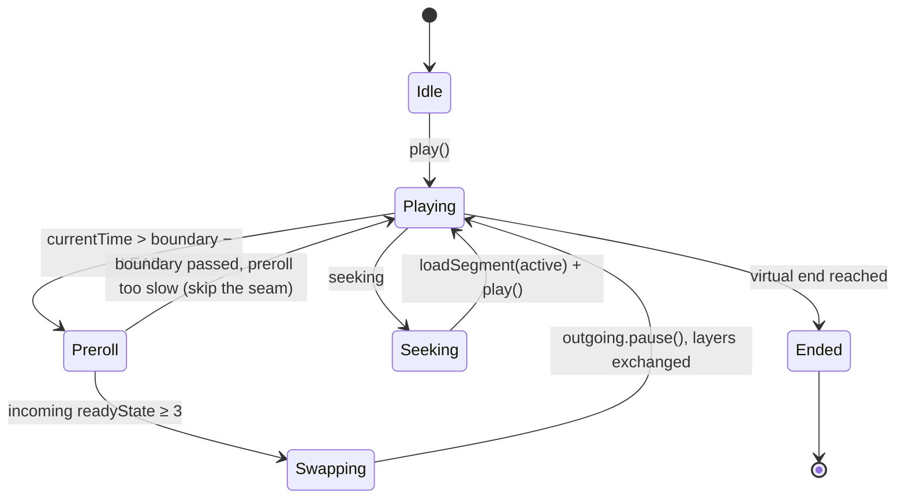

# 04 — Simple Engine (Method B, fallback / any-MP4 mode)

Two stacked `<video>` elements, pre-rolled, swapped at the boundary. No MSE, no
codec constraints, works with any MP4 Chrome can decode. Costs one frame of
precision and a little decode headroom.

Use it when: codecs mismatch, MSE refuses the file, the Phase 0 spike fails, or
the user just wants to eyeball the edit.

## Step 1 — The stage

```html
<div class="stage">
  <video class="layer a" playsinline preload="auto"></video>
  <video class="layer b" playsinline preload="auto"></video>
</div>
```

```css
.stage { position: relative; aspect-ratio: var(--ar); background: #000; }
.layer { position: absolute; inset: 0; width: 100%; height: 100%; object-fit: contain; }
.layer[data-hidden] { opacity: 0; pointer-events: none; }
```

Both elements are always in the DOM and always `preload="auto"`. Removing or
re-creating elements per segment is what produces the classic 300 ms black frame.

## Step 2 — `loadSegment(segment, virtualTime)`

```ts
function loadSegment(el: HTMLVideoElement, seg: Segment, virtT: number) {
  const srcT = seg.srcIn + (virtT - seg.virtIn);
  if (el.dataset.srcKey !== seg.assetId) {
    el.src = assetUrl(seg.assetId);          // objectURL, cached per asset
    el.dataset.srcKey = seg.assetId;
  }
  el.currentTime = srcT;
}
```

Seeking a pre-loaded element to a nearby time is a few milliseconds; setting
`src` is tens to hundreds. Cache the object URLs per asset so `src` changes are
rare.

## Step 3 — Pre-roll the incoming layer

When the playhead is within `LEAD` (≈ 1.5 s) of a segment boundary:

```ts
incoming.src = nextAssetUrl;
incoming.currentTime = nextSeg.srcIn - LEAD;   // start LEAD before its content
incoming.muted = true;                         // audio is swapped, not blended
await raf(() => incoming.play());              // buffered + already rolling
```

Starting the incoming element **muted and hidden, `LEAD` early**, is what makes
the swap seamless:

- the decoder is warm and has frames queued,
- its clock is already running, so at the boundary it is at exactly `srcIn`,
- the swap becomes two style changes instead of a `play()` call, and `play()`
  latency (10–80 ms) is the entire error budget.

## Step 4 — Swap

```ts
function maybeSwap(now: number) {
  const next = nextBoundary(now);
  if (incoming && now >= next - 0.050) {
    incoming.currentTime += (next - now);        // correct residual drift
    incoming.muted = audioMode === 'replace';    // see 07
    outgoing.dataset.hidden = '';
    incoming.removeAttribute('data-hidden');
  }
  if (incoming && now >= next) {
    outgoing.pause();
    [outgoing, incoming] = [incoming, outgoing];
  }
}
```

Two discrete moments: **50 ms before** the boundary, put the incoming layer on
screen so the first frame lands exactly on the cut; **at** the boundary, retire
the outgoing layer. This avoids a black frame and avoids the outgoing layer's
last frame bleeding into the incoming one.

## Step 5 — Clock discipline

Drift is the enemy. On every `requestVideoFrameCallback` of the active layer:

```ts
const expect = seg.srcIn + (video.currentTime - seg.virtIn);
if (Math.abs(video.currentTime_actual - expect) > 0.040) {
  video.currentTime = expect;          // hard resync, rare
}
```

`requestVideoFrameCallback` gives the real presentation time of each frame, which
`timeupdate` does not (it fires ~4×/s and lags). Use rVFC for swap decisions and
`timeupdate` only for the HUD.

`requestVideoFrameCallback` is Chrome-only — which is exactly why this engine is
Chrome-first in v1. Firefox has `mozRequestVideoFrameCallback`; Safari needs a
`setInterval` + `currentTime` poll. Note it, do not build it yet.

## Step 6 — State machine



## Step 7 — Seeking and scrubbing

Scrubbing must be cheap and must not fight the swap logic:

```ts
async function seekVirtual(vt: number) {
  cancelPreroll();
  const { seg, srcTime } = locate(timeline, vt);
  loadSegment(active, seg, vt);
  incoming.removeAttribute('src');      // release the decoder
  await once(active, 'seeked');
  if (wasPlaying) await active.play();
}
```

Throttle to one seek per animation frame while dragging; `video.currentTime`
writes on every `pointermove` will queue and stutter.

## Step 8 — Decoder budget

Chrome limits simultaneous decoders (~4–16 depending on platform/resolution).
Two elements is safe. Never pre-roll more than one lookahead segment, and always
clear `src` on the idle layer when it is far from a boundary — otherwise a 4K
main plus a 4K clip plus a lookahead will fail to start the third one silently.

## Step 9 — What this engine does *better*

- Any MP4, any codec combination, any resolution mix.
- True audio mixing is possible (both elements can be audible, main at reduced
  volume) — but keep it consistent with the MSE engine's `hold` mode (see `07`).
- No `QuotaExceededError`, no buffer eviction, no memory ceiling.

## Step 10 — What it costs

| Property | Value |
|---|---|
| Boundary precision | 1 frame typical, 100+ ms worst case on a cold decoder |
| Gap risk | low, non-zero; no guarantee |
| A/V | exact per segment, drift-free (both elements are independent) |
| Seek cost | real `seeked` wait per segment change |

Show a `seam risk` indicator in the HUD when the incoming `readyState` is below 3
at swap time, so a bad seam is attributed to the engine and not to the edit.

## Acceptance checklist

- [ ] 3 insertions, no black frames, no audible gap at any boundary.
- [ ] 10-minute playthrough with zero drift between element time and expected time.
- [ ] Dragging the scrubber never leaves a stuck layer.
- [ ] Idle layer has no `src` after 10 s away from a boundary.
- [ ] Clip with no audio plays silent without muting the main layer incorrectly.
- [ ] HUD reports the seam risk when pre-roll was too slow.
