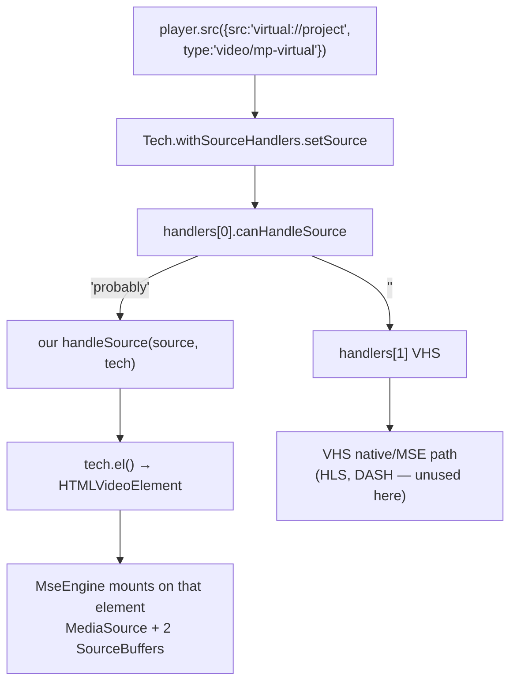

# 05 — video.js Engine (Method C)

video.js is a **skin and control layer** here, not a new playback mechanism. We
register a source handler that hands video.js's own `<video>` element to the exact
same `MseEngine` from `03`. So the seam, the scheduler, and the audio path are
byte-identical to the native engine — only the chrome around the video changes.

## Step 0 — Pin the version (important)

**Use `video.js@8.24.1`, not 10.x.**

Verified by inspecting the published packages:

| Version | `Tech.registerSourceHandler` | `getTech` |
|---|---|---|
| 8.24.1 | present (`dist/video.es.js`) | present |
| 10.4.0 | **absent** — v10 removed the Tech/source-handler architecture | absent |

v10 is a ground-up rewrite with no custom-tech extension point, so a
virtual-timeline source cannot be plugged into it. Pin 8 and note the constraint.

## Step 1 — Install and mount

```ts
import videojs from 'video.js';
import 'video.js/dist/video-js.css';
```

```html
<div class="stage">
  <video-js id="player" class="vjs-big-play-centered" playsinline></video-js>
</div>
```

Initialize with `controls: true`, `fluid: false` (we size the container),
`preload: 'auto'`, `sources: []`. **Do not pass a `src`.** The handler supplies it.

## Step 2 — The custom source type

Pick a type nothing else claims:

```
video/mp-virtual
```

`src` is a meaningless opaque key (`virtual://project`). Its only job is to make
video.js route the source to our handler.

## Step 3 — Register the handler

```ts
import videojs from 'video.js';

const VirtualSourceHandler = {
  name: 'mp-virtual',

  canHandleSource(srcObj, options) {
    return this.canPlayType(srcObj.type);
  },

  canPlayType(type) {
    return type === 'video/mp-virtual' ? 'probably' : '';
  },

  handleSource(source, tech) {
    const el = tech.el();                    // the real HTMLVideoElement
    const engine = new MseEngine(el);        // ← same engine as method A
    engine.setTimeline(currentTimeline);
    return {
      source,
      dispose() { engine.destroy(); },
    };
  },
};

videojs.getTech('Html5').registerSourceHandler(VirtualSourceHandler, 0);
```

**Index `0` is not optional.** video.js registers its own VHS handler at index 0
(`videojs.getTech('Html5').registerSourceHandler(VhsSourceHandler, 0)` inside the
bundle); handlers are consulted in array order. Registering at 0 puts ours first.
VHS's `canHandleSource` returns `''` for unknown types anyway, so there is no
conflict — but the ordering will save you debugging later if VHS tightens its check.

## Step 4 — Resolution order



## Step 5 — One `src` set, forever

After the initial `player.src(...)`, nothing calls `player.src()` again. Edits go
through the engine, not through video.js:

```ts
engine.setTimeline(nextTimeline);     // flushes + refills, src untouched
```

If any code path calls `player.src()`, video.js will tear down the handler
(`dispose`) and request a new source → new MediaSource → a real reload. Treat
`player.src` as a one-shot. Grep for it during review.

## Step 6 — Controls and the virtual timeline

video.js reads `duration`, `currentTime`, `buffered`, and `seekable` off the tech,
which are MSE values — so the transport bar is **already** the virtual timeline
with no work:

| Control | Behaviour |
|---|---|
| duration | `ms.duration` = virtual total (set in `03` step 3) |
| progress bar fill | real, reflecting `buffered` |
| seek | writes virtual `currentTime`; engine handles the refill |
| play/pause | passthrough |
| volume | passthrough (`video.volume`) |
| playback rate | passthrough — **but** see the warning below |
| fullscreen/PiP | works, element-level |

**Clip markers.** Overlay them, do not hack video.js internals:

```ts
const bar = player.el().querySelector('.vjs-progress-control');
const marks = document.createElement('div');
marks.className = 'clip-marks';
bar.appendChild(marks);
// for each clip segment: left = virtIn / duration * 100%
```

Position with percentages so it survives video.js re-laying out the bar. Markers
are pointer-events:none, so seeking still works everywhere on the bar.

## Step 7 — Playback rate caveat

`playbackRate ≠ 1` changes how fast the playhead traverses the window. The pump
formula (`LOOKAHEAD` seconds of media ≈ 30 s of wall time) still holds because it
is expressed in media time — but the refill must keep up at 2×. Multiply the
lookahead by `playbackRate` when it is above 1, or the user hits `waiting` at 2×.

## Step 8 — Switching engines without losing the edit

```ts
async function switchEngine(next: 'native' | 'videojs') {
  const anchorMain = toMain(timeline, currentVirtualTime());
  const t = toVirtual(timeline, anchorMain);

  if (player) { player.dispose(); player = null; }   // disposes our handler → engine.destroy()

  if (next === 'videojs') player = mountVideoJs(container);
  else mountNative(container);

  await engine.setTimeline(timeline);
  engine.seekVirtual(t);
}
```

The edit model, assets, and fragment store are engine-independent, so switching is
cheap: fragments are not re-indexed, only re-appended.

## Step 9 — Things that will annoy you

- `tech.el()` is available **inside** `handleSource`, not before. Do not try to
  grab the element from `player.el().querySelector('video')` — during
  registration the tech may not exist yet.
- video.js adds `.vjs-*` classes and a poster overlay; the loading spinner is
  driven by the `waiting`/`canplay` events, so our refill shows a spinner for
  free.
- `tech.el()` may be reused if video.js reuses the tech; `dispose()` must fully
  tear down the MediaSource and revoke the object URL.
- Do not enable the `http-streaming` overrides for our type; VHS must never see
  `video/mp-virtual`.
- video.js 8 still ships VHS in the default build (~150 KB gzip extra). Acceptable;
  a custom build without VHS is possible but not worth the maintenance in v1.

## Acceptance checklist

- [ ] `video/mp-virtual` routes to our handler (log inside `handleSource`).
- [ ] Progress bar shows virtual duration; clip markers align with the same
      percentages the native engine's timeline strip uses.
- [ ] Play through 3 insertions with no seam — identical result to method A.
- [ ] Switching native ⇄ video.js mid-edit resumes at the same main-video frame.
- [ ] `player.src` is called exactly once per mount (assert in a test hook).
- [ ] Disposing the player leaves no MediaSource, no object URL, no listeners.
