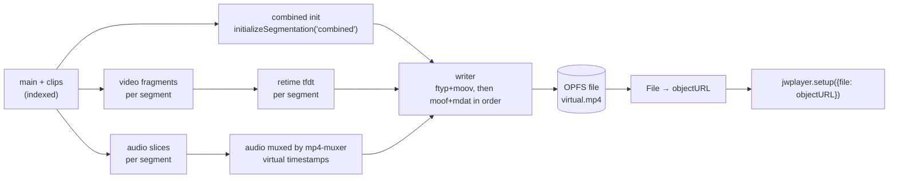

# 06 — JW Player Engine (Method D, optional)

**JW Player has no public MSE extension point.** video.js exposes source handlers;
JW Player 9 does not expose an equivalent, and there is no supported way to hand
it a `MediaSource`. So this engine cannot share the streaming path — it produces a
single seekable file first, then lets JW play that file.

Status: optional, behind a license key. Build it last.

## Step 0 — What was considered and rejected

| Approach | Verdict |
|---|---|
| Playlist with `starttime` per item | **Rejected.** This is the exact "stop, load, start" gap the whole project exists to avoid. |
| `jwplayer().load()` at the boundary via a `time` listener | **Rejected.** Same gap, plus a seek. |
| Custom provider | Does not exist in v9's public API. |
| Wrap JW's internal element | JW owns its video element; attaching a MediaSource to it is unsupported and breaks on version updates. |
| **Pre-remux to one fragmented MP4, play that** | **Chosen.** Seamless because it is literally one file, seekable, and uses only supported APIs. |

## Step 1 — Remux pipeline

We already have exactly the pieces needed from `02`: a per-track init segment and
RAP-aligned video fragments, plus sliced audio. Materialising them into one file
requires no decoding and no re-encoding — only **timestamp rewriting**.



## Step 2 — Retime video fragments by patching `tfdt`

Each fragment is a `moof`+`mdat` pair. Its decode time lives in
`moof > traf > tfdt > baseMediaDecodeTime`. Shift it so the fragment lands at its
virtual time:

```
delta     = seg.virtIn - seg.srcIn              // seconds, same for the whole segment
newBase   = round((fragSrcStart + delta) * trackTimescale)
```

Implementation notes that matter:

1. **Force `tfdt` version 1 (64-bit, 4-byte version/flags + 4 + 8).** If a source
   fragment has a version 0 (32-bit) tfdt, upgrading it changes the box size and
   invalidates `trun` data offsets. Write the box as v1 and, if the size changes,
   recompute the enclosing `moof` size and every `trun` `data_offset`.
2. **Keep `default-base-is-moof` intact.** mp4box fragments use it; do not touch
   `tfhd` offsets.
3. **Renumber `mfhd.sequence_number`** sequentially from 1. Chrome tolerates
   duplicates for local files, other consumers may not.
4. `mdat` payloads are copied verbatim — this is a memcpy, not a transcode, so a
   remux runs at disk speed (hundreds of MB/s).

## Step 3 — Audio

Audio slices come from the `02` slicing path already carrying virtual timestamps.
Mux them with `mp4-muxer` in **audio-only** mode into the same output file, or
splice their `moof`s with the same `tfdt` patch. Audio-only muxing is the simpler
of the two: `new Muxer({target, audio: {...}, fastStart: 'fragmented'})`, then
`addAudioChunk` per slice with `timestamp` already in virtual microseconds.

A clip with no audio track contributes no chunks. Keep the audio track's timeline
continuous by leaving the silence in — do **not** compact it, or every subsequent
audio timestamp shifts.

## Step 4 — Write without holding the file in RAM

`mp4-muxer`'s `StreamTarget` writes sequentially, which fits OPFS perfectly:

```ts
const root = await navigator.storage.getDirectory();
const handle = await root.getFileHandle('virtual.mp4', { create: true });
const access = await handle.createSyncAccessHandle();   // worker only
// onData: access.write(chunk, { at: position })
```

Chrome-only API, worker-only, and it needs a `navigator.storage.estimate()`
headroom check: a 30-minute project can be 1–2 GB. If OPFS is unavailable, fall
back to `ArrayBufferTarget` and cap the project size with a clear warning.

## Step 5 — Hand it to JW Player

```html
<script src="https://cdn.jwplayer.com/libraries/<PLAYER_LIBRARY_ID>.js"></script>
```

```ts
const file = await handle.getFile();
const url = URL.createObjectURL(file);

jwplayer(container).setup({
  file: url,
  width: '100%',
  aspectratio: '16:9',
  autostart: false,
  playbackRateControls: true,
});
```

- The CDN URL is license-specific; also set `jwplayer.key` if the account requires
  it. Store the key in the app settings and **never** in source control.
- Blob URLs work through JW's HTML5 provider.
- Because it is one file, `jwplayer().getDuration()` and `getPosition()` are
  already virtual times. Editing means re-remuxing, so disable the edit UI while a
  remux is running.

## Step 6 — Clip markers on JW's slider

JW's control bar is closed (Shadow-DOM-free but versioned), so overlay rather
than inject:

```css
.container .jw-slider-time { position: relative; }
.clip-marks { position: absolute; inset: 0; pointer-events: none; z-index: 2; }
```

`left: calc(virtIn / duration * 100%)`. Recompute on `resize`; JW re-renders the
slider on skin changes.

## Step 7 — Cost model (why this is not the default)

| | MSE (A/C) | JW (D) |
|---|---|---|
| Time to first frame | ~1 s after indexing | after a full remux (10–40 s typical) |
| Memory | window only | OPFS, ~file size |
| Edit latency | re-buffer at the playhead | full re-remux |
| Seam quality | exact | exact (one file) |
| Dependencies | mp4box | mp4box + mp4-muxer + JW license + CDN |

Surface a determinate progress bar during the remux with a cancel button, and
cache the result keyed by a hash of the timeline so switching engines twice does
not remux twice.

## Step 8 — Verify fMP4-in-blob-seekability early

Chrome generally seeks a fully-local fragmented MP4 by scanning `moof`s, but this
is the assumption that makes or breaks this engine. In the spike, confirm:

- [ ] a fragmented MP4 assembled from patched fragments plays from a blob URL,
- [ ] seeking to 70 % lands on the right frame,
- [ ] duration is reported correctly (a missing/incorrect `mvhd` duration makes
      the bar read `Infinity`),
- [ ] audio stays in sync after 3 splices.

If any fails, add a `sidx` per fragment group, or emit `fastStart: 'in-memory'`
via `mp4-muxer` for smaller projects.

## Acceptance checklist

- [ ] Remuxed file plays end to end in JW with no visible or audible seam.
- [ ] Clip markers overlay correctly at all slider widths.
- [ ] Remux progress is determinate and cancellable; cancelled remux leaves no
      partial file in OPFS.
- [ ] Engine switch JW → native keeps the same main-video frame.
- [ ] Missing license key produces a clear setup message, not a blank player.
